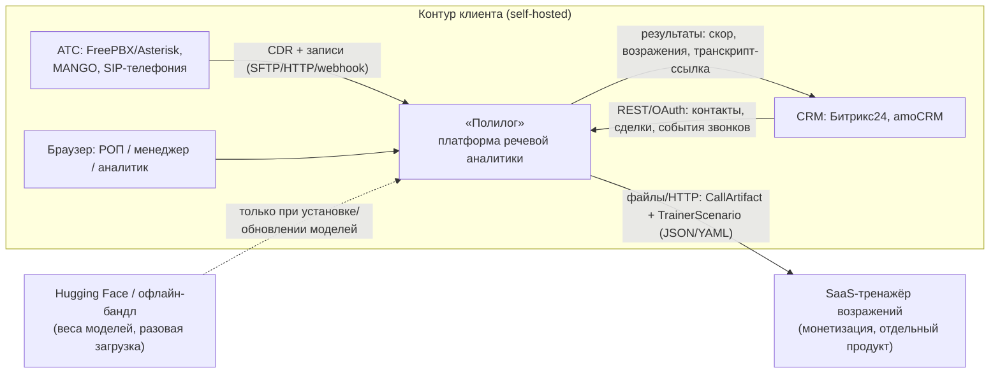
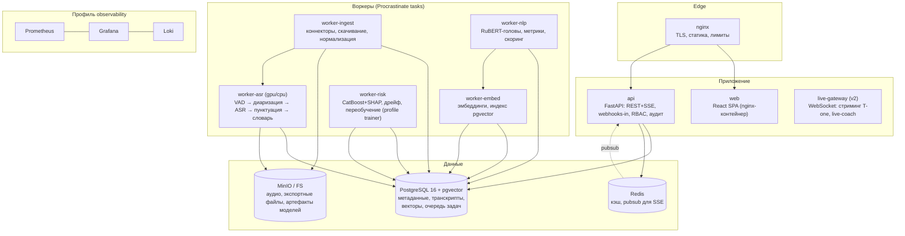

# 01. Архитектура системы «Полилог»

**Версия:** 1.0 · **Дата:** 2026-10-03 · **Статус:** утверждено к реализации MVP

---

## 0. TL;DR

Self-hosted платформа речевой аналитики для отделов продаж МСБ (СНГ): записанные звонки с телефонии автоматически транскрибируются локальной ASR-моделью, размечаются ролями, анализируются дообученным RuBERT-энкодером (возражения, сигналы интереса, метрики разговора), получают объяснимый скоринг (каждый балл — с цитатой из транскрипта) и предиктивную оценку риска срыва сделки (эмбеддинги + CatBoost). Граф «номер → контакт → компания → сделка → цепочка звонков» восстанавливает Customer 360.

**Форма решения:** модульный монолит + воркеры на одной ноде, docker-compose, PostgreSQL+pgvector как единое хранилище (включая эмбеддинги и очередь задач), GPU-бюджет ≤ 8 ГБ VRAM за счёт последовательных стадий обработки и лёгких моделей. Данные не покидают контур: модели скачиваются один раз или ставятся офлайн-бандлом.

---

## 1. Продукт, бизнес-модель, ограничения

### 1.1 Продуктовые цели

1. Менеджер/РОП за 2 минуты на звонок понимает: что произошло, какие возражения прозвучали, отработаны ли они, риск ли сделка — каждый вывод подкреплён цитатой и таймкодом.
2. Установка ≤ 1 часа: `docker compose --profile gpu up` + мастер настройки коннектора.
3. Данные клиента (аудио, транскрипты, ПДн) не покидают его периметр — ни на этапе работы, ни на этапе дообучения.
4. Open-source на GitHub как канал дистрибуции и доверия; монетизация — отдельный SaaS-тренажёр возражений, интеграция только через стандартизированный обменный формат ([doc 05](05-exchange-format.md)).

### 1.2 Целевые профили заказчика

| Профиль | Звонков/мес | Средняя длительность | Конфигурация |
|---|---|---|---|
| Микро (5–10 менеджеров) | 1–3 тыс. | 3–7 мин | CPU-only: 4–8 ядер, 16–32 ГБ RAM |
| Малый (10–40 менеджеров) | 5–20 тыс. | 3–7 мин | 8 ядер, 32–64 ГБ RAM, RTX 5060 8 ГБ |
| Средний (40–100 менеджеров) | 20–60 тыс. | 3–7 мин | + второй GPU-воркер или более мощный GPU |

Объём аудио: ~1 МБ/мин (mp3/m4a) → 20 тыс. звонков × 5 мин ≈ 100 ГБ/мес. Диск 2 ТБ SSD ≈ 12–18 месяцев хранения аудио в скользящем окне ретенции.

### 1.3 Ключевые технические ограничения

- **VRAM ≤ 8 ГБ** (RTX 5060) — все GPU-стадии проектируются с явным бюджетом памяти (§5).
- **CPU-only режим обязателен** — тот же пайплайн работает без GPU (T-one ONNX INT8, лёгкие энкодеры на CPU).
- **Локальность**: телеметрия opt-in; веса моделей — офлайн-бандл или первый запуск из Hugging Face; дообучение — только на-prem.
- **Асинхронный пайплайн** — SLA «звонок проанализирован ≤ 10 минут после завершения» (batch), realtime — отдельный трек v2 (§12).
- **Русский язык — основной**, но ASR-адаптер позволяет подключить Whisper для мультиязычных команд (ru/kz/uk-смеси).

---

## 2. Анализ бест-практик (исследование, октябрь 2026)

### 2.1 Рынок: ниша подтверждена

Прямых open-source аналогов с полным набором (транскрибация + роли + возражения + объяснимый скоринг + граф Customer 360 + обменный формат) на рынке нет. Существующие self-hosted решения — meeting-ассистенты (транскрибация встреч) и коммерческие speech analyticsenterprise-платформы (CallMiner-класс, дорого, облако). Конкурентное преимущество «локальность + русскоязычность + низкий порог железа» реализуемо и не занято.

### 2.2 ASR для русской телефонной речи

| Модель | Размер | Домен | Сильные стороны | Ограничения | Лицензия |
|---|---|---|---|---|---|
| **GigaAM-v3 RNNT/CTC** (Salute Developers) | 220–240M | универсальный ru | SOTA WER на русском (Golos, OpenSTT), быстрее Whisper, коммерческое использование | нет стриминга, сырая пунктуация | MIT-семейство, коммерч. OK¹ |
| **T-one** (Т-Технологии) | ~70M | телефония ru | потоковое распознавание сегментами 300 мс, обучена на зашумлённых записях колл-центров, лёгкая (CPU), 8 кГц нативно | русский only, CTC-декодер без лексикон-байесинга из коробки | open source, коммерч. OK¹ |
| Whisper-large-v3-turbo | 809M | мультиязычный | язык не важен, initial_prompt (байес словарём), пунктуация «из коробки» | тяжелее, хуже на телефонной 8 кГц для ru, галлюцинации на тишине | MIT |
| Vosk | 50M–1.8G | универсальный | CPU, стриминг, Kaldi-лексикон (словарь-байес!) | WER хуже GigaAM/T-one | Apache 2.0 |

¹ Точные лицензии фиксируем в `model_registry` при поставке; обе модели официально открыты для коммерческого применения.

**Решение:** ASR-адаптер (плагин). Основная связка: **GigaAM-v3 RNNT — для batch-анализа**, **T-one — для CPU-режима и будущего realtime**, Whisper — опциональный мультиязычный адаптер. Источники: [github.com/salute-developers/GigaAM](https://github.com/salute-developers/GigaAM), [github.com/t-tech/T-one](https://github.com/t-tech/T-one), [arXiv:2506.01192](https://arxiv.org/abs/2506.01192). Финальный выбор дефолта — по бенчмарку на телефонном канале 8 кГц (golden-набор из открытых датасетов — см. [doc 06](06-datasets.md)).

**Доменный словарь.** Прямого словарь-байесинга GigaAM из коробки нет — поэтому словарь организации реализуем трёхслойно (детально §5.2 [doc 02](02-modules.md)): (1) пост-ASR фонетическая коррекция гомофонов и названий (RapidFuzz + русский фонетический ключ), (2) словарь организации в UI (товары, бренды, жаргон, аббревиатуры) с импортом CSV, (3) research-трек: CTC shallow fusion / deep contextual biasing для CTC-варианта. Слой (1) работает для любого ASR — это принципиально для сменности моделей.

### 2.3 Энкодеры и эмбеддинги (русский)

| Модель | Что это | Почему берём |
|---|---|---|
| **deepvk/RuModernBERT-base** (~150M) | русский ModernBERT: 8192 токена контекста, быстрый attention (RoPE+FA2) | дообучение голов (возражения/сигналы/тональность) на 8 ГБ VRAM через LoRA; длинный контекст = целые диалоги за один проход |
| **deepvk/USER2-base** | контрастивно дообученный RuModernBERT для retrieval/STS (наследник USER-bge-m3) | эмбеддинги фраз/звонков для поиска и предиктив-фич; 768 dim |
| ai-forever/FRIDA, ru-en-RoSBERTa | альтернативные ru-эмбеддеры | резерв в бенчмарке на eval-наборе |

Правило из RAG-практики: **модель эмбеддингов выбирается бенчмарком на своём eval-наборе** ( Recall@5 ≥ 0.85 на задаче «похожие фрагменты звонков»), а не по популярности; в системе `model_registry` хранит `model_id + dim + version`, векторы перезаписываются при смене модели (фоновая переиндексация).

Источники: [deepvk/RuModernBERT-base](https://huggingface.co/deepvk/RuModernBERT-base), [deepvk/USER-bge-m3](https://huggingface.co/deepvk/USER-bge-m3), [arXiv:2504.12879](https://arxiv.org/pdf/2504.12879).

### 2.4 Определение ролей (диаризация)

1. **Стерео-каналы (приоритет 1, телефония):** большинство АТС (FreePBX, MANGO, Битрикс24-телефония) пишут агента и клиента на разные каналы. Это бесплатная 100%-точная диаризация — используем всегда, когда recording содержит 2 канала; карта каналов приходит из метаданных коннектора.
2. **pyannote 3.1 / NVIDIA Sortformer (фолбэк):** моно-записи, конференции >2 участников. Sortformer показал лучшие метрики, чем pyannote, и поддерживает стриминг до 4 спикеров (актуально для v2).
3. **Эвристики + подтверждение UI:** назначение «агент/клиент» по каналам с проверкой (агент = первый говорит, приветствие), ручное исправление ролей в редакторе транскрипта → попадает в labels для переобучения.

### 2.5 Инфраструктурные решения (по system-design wiki)

- **БД:** масштаб МСБ — «< 1 ТБ, < 100K QPS» → **PostgreSQL single instance** (ACID, joins, JSONB) + **pgvector** для векторов + TimescaleDB не нужен на этом объёме (агрегаты через materialized views). КликхHouse рассматривать при >50 тыс. звонков/мес и BI-нагрузках (v2+).
- **Очередь:** это **task queue** («обработать звонок, повторить при падении воркера»), а не event log → Kafka противопоказана (нет пер-сообщ ACK, высоки ops-издержки). На одной ноде минимальный ops-след даёт **очередь на PostgreSQL** (Procrastinate: SKIP LOCKED, retries, cron) — ноль дополнительной инфраструктуры, транзакционная гарантия «строка звонка + задача в очереди» атомарно. RabbitMQ — точка масштабирования (см. §10).
- **Аудио:** объектное хранение — MinIO (или bind-mount FS) с версионированием; в БД — только пути и метаданные.
- **Кэш/pubsub:** Redis — SSE-уведомления UI, кэш дашбордов, rate limiting.

### 2.6 ML-инженерные практики (приняты как обязательные)

Из ai-ml-engineering: eval-харнесс пишется **до** обучения; базовая линия (rules + логрегрессия) обязана быть побита осмысленным отрывом; time-based split (никаких случайных сплитов — утечка через одинаковые контакты!); контроль утечек и PII в тренировочных данных; воспроизводимость (версии данных, seeds, гиперпараметры в `training_runs`); staged rollout моделей (canary 5% → 100%); мониторинг дрейфа (PSI по фичам, WER по golden-набору).

Из rag-system-design: eval-набор retrieval 50+ пар до выбора эмбеддера; Recall@5/Precision@5/MRR; метаданные рядом с векторами (org_id, call_id, ts) для фильтрации; атрибуция цитат в выдачах.

Из security-and-hardening: STRIDE threat model, валидация на границе, никакой PII в логах, шифрование at rest/in transit, proper deletion (каскад аудио→транскрипт→эмбеддинги), минимальные привилегии сервисов.

---

## 3. Архитектурные принципы

1. **Локальность данных-first** — любая фича сначала проверяется на «работает ли без сети».
2. **Модульный монолит, чистые границы** — Python-пакеты `ingest / media / asr / nlp / scoring / embedding / risk / graph / export / api`; выделение в отдельные сервисы — только по профилированию нагрузки, границы не ломаются.
3. **Плагины на всех швах** — коннекторы телефонии, ASR-адаптеры, анализаторы, экспортёры; реестр плагинов + conformance-тесты.
4. **Идемпотентные стадии** — пайплайн как state machine на строке звонка; любая стадия перезапускается без дублей; DLQ + ручной репроцессинг из UI.
5. **Объяснимость обязательна** — ни одного числа без доказательства (цитата + таймкод + метод).
6. **Дешёвый базовый профиль** — всё работает на CPU; GPU ускоряет, но не является зависимостью.
7. **Формат — это контракт** — обменный формат версионируется семантически, эволюция additive-only в minor-версиях.

## 4. C4: контекст и контейнеры

### 4.1 Системный контекст



SaaS-тренажёр **не подключается** к платформе напрямую: обмен только файлами/HTTP-выгрузкой по [обменному формату](05-exchange-format.md). Hugging Face доступен опционально и только на этапе установки/обновления весов.

### 4.2 Контейнеры



### 4.3 Таблица контейнеров

| Контейнер | Технология | Ответственность | Масштабирование |
|---|---|---|---|
| `api` | FastAPI, uvicorn | REST, SSE, webhooks, authn/authz, аудит, выдача экспортов | 1–2 реплики (stateless) |
| `web` | React/Vite static | UI: дашборды, транскрипты, скоры, Customer 360, админка | nginx static |
| `worker-ingest` | Python, Procrastinate | поллинг/webhook коннекторов, скачивание аудио, ffmpeg-нормализация, чек-суммы | 1+ |
| `worker-asr` | Python, torch/onnxruntime | VAD (Silero), роли, ASR, пунктуация, словарь-коррекция | 1 на GPU; N на CPU |
| `worker-nlp` | Python, transformers | сегментация, RuBERT-головы, метрики, скоринг-рул | 1+ |
| `worker-embed` | Python, sentence-transformers | эмбеддинги звонков/фраз/профилей, запись в pgvector | 1 (CPU) |
| `worker-risk` | Python, catboost, shap | скоринг риска, периодический рефит, PSI-дрейф | 1 |
| `scheduler` | Procrastinate cron | поллинги коннекторов, ретенции, переиндексация, healthcheck | встроен в воркеры |
| `postgres` | PostgreSQL 16 + pgvector | всё состояние (кроме аудио) + очередь задач | 1 (монолит-нода) |
| `redis` | Redis 7 | pubsub для SSE, кэш, лимиты | 1 |
| `minio` | MinIO / bind FS | аудио, экспортные пакеты, артефакты моделей | 1 |

## 5. Пайплайн обработки звонка

### 5.1 State machine звонка

```
discovered → downloading → downloaded → normalized → diarized → transcribed
→ lexicon_corrected → analyzed → scored → embedded → risk_assessed → done
                                                    ↘ failed(stage, error) → retry/backoff → dead_letter
```

- Состояние и `stage_error` живут в строке `calls`; каждая стадия — идемпотентная задача Procrastinate с отдельным потоком (ретраи с backoff, DLQ-таблица, кнопка «Перезапустить с стадии X» в UI).
- Промежуточные артефакты (нормализованный WAV, сырой транскрипт) лежат в MinIO с content-hash именами — репроцессинг не дублирует файлы.

### 5.2 Sequence — нормальный путь

```mermaid
sequenceDiagram
    autonumber
    participant PBX as АТС/CRM
    participant ING as worker-ingest
    participant S3 as MinIO
    participant ASR as worker-asr
    participant NLP as worker-nlp
    participant EMB as worker-embed
    participant RSK as worker-risk
    participant PG as PostgreSQL

    PBX->>ING: событие/webhook или поллинг (внешний id, ссылка на запись, участники)
    ING->>PG: upsert call (state=discovered), resolve contact/company, previous_call_id
    ING->>S3: скачать аудио, sha256, нормализация (16k PCM, карта каналов)
    ING->>ASR: задача diarize+transcribe
    ASR->>ASR: Silero VAD → роли (каналы | pyannote) → GigaAM/T-one → пунктуация → словарь
    ASR->>S3: транскрипт (JSON: фразы, слова, тайминги, conf)
    ASR->>NLP: задача analyze
    NLP->>NLP: RuBERT-головы: возражения, сигналы, тональность, стадии; метрики из таймингов
    NLP->>NLP: скоринг по рубрике org (каждый балл ← цитата)
    NLP->>PG: сегменты, возражения, сигналы, метрики, scores
    NLP->>EMB: задача embed
    EMB->>PG: векторы фраз и звонка (USER2 → pgvector)
    EMB->>RSK: задача risk
    RSK->>PG: вероятность срыва + SHAP-факторы (если сделка активна)
    RSK-->>PBX: (опция) исходящий webhook + запись результата в CRM
```

### 5.3 SLA и пропускная способность

| Стадия | GPU (RTX 5060) | CPU (8 ядер) |
|---|---|---|
| Нормализация (ffmpeg) | RTF ≈ 0.1 | RTF ≈ 0.3 |
| VAD (Silero) | RTF ≈ 0.005 (CPU) | RTF ≈ 0.01 |
| ASR GigaAM-v3 RNNT | RTF ≈ 0.02–0.05 | — (только T-one) |
| ASR T-one ONNX INT8 | RTF ≈ 0.01 | RTF ≈ 0.2–0.4 |
| Диаризация pyannote (моно) | RTF ≈ 0.05 | RTF ≈ 0.5 |
| NLP-головы (RuModernBERT) | RTF < 0.01 | RTF ≈ 0.05–0.1 |
| Эмбеддинги (USER2) | — | RTF ≈ 0.03 |

RTF = время обработки / длительность аудио. Профиль «малый бизнес»: 20 тыс. звонков/мес ≈ 100 тыс. мин/мес ≈ 3.3 тыс. мин/день. На GPU суммарный конвейер ~RTF 0.1 → ~5.5 GPU-часов/день — запас есть даже с переобучением ночью. CPU-only ~RTF 0.6 → ~33 ядро-часов/день → 8 ядер справляются с пиковым буфером за ночь (приоритет: свежие звонки первыми).

## 6. VRAM-бюджет (8 ГБ, RTX 5060)

Принцип: **GPU-стадии выполняются последовательно** (модель-менеджер выдаёт GPU-аренду задачам), параллельность — внутри стадии батчами. Эмбеддинги и NLP по умолчанию на CPU.

| Модель | Режим | Память | Примечание |
|---|---|---|---|
| GigaAM-v3 RNNT (242M) | fp16, чанки 60с × батч 8 | 2.5–4 ГБ | основная ASR |
| T-one (70M) | ONNX INT8 | < 1 ГБ | CPU/реалтайм-трек |
| pyannote 3.1 (сегм.+эмбеддер) | fp16 | ≈ 1 ГБ | только для моно |
| RuModernBERT-base + LoRA | обучение, seq 512, батч 16 | 3–5 ГБ | профиль `trainer`, ночные окна |
| USER2-base | инференс | 0.5 ГБ | обычно CPU |
| Silero VAD | ONNX | < 0.1 ГБ | CPU |

Guardrails: `torch.cuda.mem_get_info` перед выделением, автофолбэк стадии на CPU при OOM, лимит одновременных GPU-задач = 1 (обучение) / 2 (инференс), метрики VRAM в Prometheus.

## 7. Развёртывание и эксплуатация

### 7.1 docker-compose профили

```yaml
# docker-compose.yml (эскиз)
services:
  api:        { profiles: [base] }
  web:        { profiles: [base] }
  postgres:   { profiles: [base] }   # image с pgvector
  redis:      { profiles: [base] }
  minio:      { profiles: [base] }
  worker-ingest: { profiles: [base] }
  worker-nlp:    { profiles: [base] }
  worker-embed:  { profiles: [base] }
  worker-risk:   { profiles: [base] }
  worker-asr:    { profiles: [cpu],  environment: [ASR_BACKEND=onnx] }
  worker-asr-gpu:{ profiles: [gpu],  deploy: { resources: { reservations: { devices: [gpu] } } } }
  trainer:       { profiles: [trainer] }  # fine-tuning, обычно ночью по расписанию
  prometheus:    { profiles: [observability] }
  grafana:       { profiles: [observability] }
  loki:          { profiles: [observability] }
```

### 7.2 Конфигурации железа

| Профиль | CPU | RAM | GPU | Диск | Ожидание |
|---|---|---|---|---|---|
| CPU-min | 4c | 16 ГБ | — | 500 ГБ SSD | ≤ 300 звонков/день, ночной дожим |
| **GPU-рекоменд.** | 8c | 32 ГБ | RTX 5060 8 ГБ | 2 ТБ SSD | 500–1500 звонков/день, SLA 10 мин |
| GPU-max | 16c | 64 ГБ | RTX 5060 ×2 | 4 ТБ | 3000+ звонков/день |

### 7.3 Модель-менеджер и офлайн-установка

- `polylog models pull` — скачивает из HF (можно проксировать), проверяет sha256, пишет в `model_registry` (id, версия, лицензия, dim, checksum).
- `polylog models bundle` — собирает tar-бандл весов для полностью офлайн-установок (`polylog models load bundle.tar.zst`).
- Лицензии моделей показываются в UI при активации; регион/список моделей — конфигурируемый.

### 7.4 Резервирование, обновления, мониторинг

- Бэкапы: `pg_dump` nightly + restic/rsync каталога аудио (инкрементально, шифрование), тестовое восстановление — runbook, RPO ≤ 24ч, RTO ≤ 4ч.
- Обновления: Alembic-миграции + blue-green (compose projects), миграции векторов — фоновая переиндексация.
- Мониторинг: глубина очередей по стадиям, RTF по стадиям, VRAM, ошибки стадий, свежесть коннекторов, дрейф WER/PSI; алерты в Grafana + опционально в Telegram-бот.
- Аудит-лог: входы, прослушивания аудио, экспорты, изменения рубрик — таблица `audit_log` (append-only).

### 7.5 Точка масштабирования (когда упрёмся)

1. Второй `worker-asr` (GPU #2) — добавляется без изменений кода.
2. Очередь на PostgreSQL → RabbitMQ (переносим Procrastinate-задачи на брокер, контракт задач не меняется) — при многонодовой установке.
3. BI-агрегаты → materialized views → ClickHouse при >50 тыс. звонков/мес.
4. Postgres → отдельная нода/managed, read-реплика на дашборды.

## 8. Дорожная карта

| Этап | Срок | Содержание | Критерий готовности |
|---|---|---|---|
| **MVP** | M1–M2 | FreePBX-коннектор, GigaAM RNNT, роли по стерео, транскрипты с таймкодами, метрики, базовый скоринг с цитатами, pgvector-поиск; dev-стенд Asterisk + датасет ([doc 09](09-dev-stand.md)); бенчмарк ASR и эталон из датасетов ([doc 06](06-datasets.md)) | приёмочные S1–S3 стенда зелёные; WER на эталоне ≤ 15% |
| **v1.0** | M3–M4 | Битрикс24 + amoCRM коннекторы, детекция возражений v1 (10 классов), PII-анонимизация, обменный формат v1.0 (экспорт), Customer 360 (цепочки previous_call_id), RBAC | пилот 3 компаний; возражения F1 ≥ 0.75 на eval-наборе |
| **v1.x** | M5–M6 | Риск-модель + SHAP, **вкладка «Аналитика компании» по графу телефонов + инсайт-лента** ([doc 08](08-predictive-analytics.md)), семантический поиск похожих звонков, модуль дообучения (LoRA), коннекторы MANGO/Sipuni/Zadarma, дашборды РОПа | риск-модель AUC ≥ 0.7 с abstention; 2 пилота с переобучением |
| **v2** | M7+ | Realtime-трек (T-one стриминг + live-coach в CRM-виджете), маркетплейс коннекторов, мультиязычность (Whisper), обкатка стандарта обменного формата | стриминг-задержка ≤ 3 с; ≥ 3 сторонних коннектора |

## 9. Риски и митигации

| Риск | Вероятность | Митигация |
|---|---|---|
| WER деградирует на «грязной» телефонии заказчика | высокая | golden-набор per-org на онбординге; цепочка фолбэков ASR; словарь-коррекция; приёмочный тест до включения биллинга |
| OOM на 8 ГБ VRAM при комбинации задач | средняя | модель-менеджер с GPU-арендой, последовательные стадии, автофолбэк на CPU, лимиты батчей |
| Ошибки диаризации на моно-записях | средняя | каналы-first дизайн; эвристики; ручная правка ролей → labels |
| Узкое место разметки для риск-модели | высокая | abstention до N≥100 закрытых сделок; глобальная cold-start модель; weak supervision из рубрик; active learning (правки аналитиков = лейблы) |
| Утечка через эмбеддинги (ПДн в векторах) | низкая | векторы удаляются каскадно вместе с ПДн; режим псевдонимизации перед эмбеддингом (маскирование PII-токенов) |
| Юридическая трактовка записи звонков заказчиком | средняя | чек-лист внедрения 152-ФЗ (doc 04), конфиг «без согласия — не анализируем», шаблоны уведомлений |
| Смена/пиратство моделей вендоров | низкая | все модели за плагином; `model_registry` с лицензиями; экспорт в ONNX для долгосрочной воспроизводимости |
| Adoption AGPL интеграторами | средняя | обменный формат под CC0 в отдельном репо; connector SDK документирован; коммерческая лицензия по запросу |

## 10. Источники (главное)

- GigaAM: [github.com/salute-developers/GigaAM](https://github.com/salute-developers/GigaAM), [arXiv:2506.01192](https://arxiv.org/abs/2506.01192)
- T-one: [github.com/t-tech/T-one](https://github.com/t-tech/T-one), [huggingface.co/t-tech](https://huggingface.co/t-tech)
- RuModernBERT/USER: [deepvk/RuModernBERT-base](https://huggingface.co/deepvk/RuModernBERT-base), [deepvk/USER-bge-m3](https://huggingface.co/deepvk/USER-bge-m3), [arXiv:2504.12879](https://arxiv.org/pdf/2504.12879)
- Диаризация: pyannote 3.x, NVIDIA Sortformer/NeMo (сравнительные обзоры 2026)
- PII: [github.com/natasha/natasha](https://github.com/natasha/natasha) (MIT), Microsoft Presidio (MIT)
- Инфра-решения: system-design wiki (PostgreSQL single-instance < 1ТБ; Kafka vs RabbitMQ — task queue ≠ event log)
