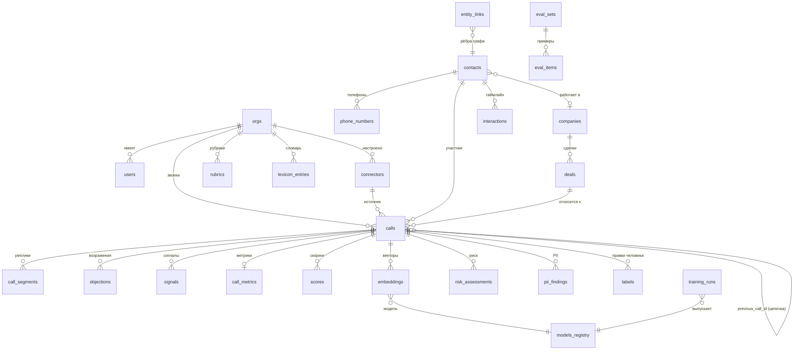

# 03. Модель данных

**Версия:** 1.0 · **Дата:** 2026-10-03 · СУБД: PostgreSQL 16 + pgvector

Единое хранилище: метаданные, транскрипты, находки, скоры, эмбеддинги, граф, очередь задач (Procrastinate), системные справочники. Аудио и большие артефакты — в MinIO/FS (в БД только пути и хеши).

---

## 1. ERD (основное)



## 2. Системные и организационные таблицы

| Таблица | Ключевые поля | Назначение |
|---|---|---|
| `orgs` | id, name, settings JSONB, locale, retention_policy JSONB | арендатор (одиночный self-hosted = 1 запись, но модель multi-org сохранена для будущих hosted-сценариев) |
| `users` | id, org_id, email, password_hash/oidc_sub, role, agent_ext_ids JSONB | RBAC; связь с внутренними номерами агентов |
| `audit_log` | id, org_id, actor_id, action, resource_type, resource_id, details JSONB, ip, created_at | append-only; никаких ПДн в details |
| `connectors` | id, org_id, kind, config JSONB (секреты — отдельная колонка encrypted), status, last_poll_at, cursor JSONB | коннекторы телефонии/CRM |
| `rubrics` | id, org_id, name, version, spec JSONB, created_by | рубрики скоринга (§4 [doc 02](02-modules.md)) |
| `lexicon_entries` | id, org_id, term, aliases[], phonetic_key, category, case_sensitive, enabled | доменный словарь |
| `models_registry` | id, kind (asr/embed/classifier/risk), model_id, version, license, checksum, dim, params JSONB, status (shadow/canary/active/retired) | все модели и их жизненный цикл |
| `training_runs` | id, kind, dataset_ref, dataset_hash, hyperparams JSONB, seed, metrics JSONB, artifact_path, created_at, promoted_at | воспроизводимость обучения |
| `eval_sets` / `eval_items` | id, kind, version / item: call_id, golden JSONB | golden-наборы WER/F1/retrieval |
| `export_jobs` | id, org_id, kind (artifact/scenario/bundle), filter JSONB, status, file_path, created_at | выгрузки обменного формата |

## 3. Звонки и результаты анализа

### 3.1 `calls` — центральная таблица

```sql
CREATE TABLE calls (
    id              uuid PRIMARY KEY DEFAULT gen_random_uuid(),
    org_id          uuid NOT NULL REFERENCES orgs,
    connector_id    uuid REFERENCES connectors,
    external_id     text,                       -- id в АТС/CRM
    direction       text NOT NULL CHECK (direction IN ('inbound','outbound','internal')),
    phone_from      text, phone_to text,        -- E.164
    agent_user_id   uuid REFERENCES users,
    contact_id      uuid, company_id uuid, deal_id uuid,   -- разрешённые связи (FK добавляются ниже)
    started_at      timestamptz NOT NULL,
    duration_sec    int,
    recording_path  text,                       -- MinIO key оригинала
    normalized_path text,                       -- MinIO key нормализованного WAV
    channels_map    jsonb,                      -- {"0":"agent","1":"client"} | null
    consent_flag    boolean,
    state           text NOT NULL DEFAULT 'discovered',
    stage_error     jsonb,
    previous_call_id uuid REFERENCES calls(id),
    thread_id       uuid,                       -- id корня цепочки (у корня = свой id)
    chain_depth     int,                        -- глубина в цепочке (денормализация)
    language        text DEFAULT 'ru',
    asr_backend_id  text,                       -- фактическая модель
    avg_conf        real,
    analyzed_at     timestamptz,
    created_at      timestamptz DEFAULT now(),
    updated_at      timestamptz DEFAULT now(),
    UNIQUE (org_id, connector_id, external_id)
);
CREATE INDEX ON calls (org_id, started_at DESC);
CREATE INDEX ON calls (org_id, state) WHERE state <> 'done';   -- очередь ретраев/мониторинг
CREATE INDEX ON calls (thread_id);
CREATE INDEX ON calls (contact_id, started_at);
```

Ключевые решения:

- **`previous_call_id` + `thread_id` + `chain_depth`** — связный список цепочки + O(1) выборка всей истории по `thread_id`; пересборка цепочки — сервисная функция при перепривязке контакта (транзакционно, с версионированием в `audit_log`).
- **`state`** — state machine пайплайна (§5 [doc 01](01-architecture.md)); частичные результаты допустимы (например, `scored` без `risk_assessed`).
- **Идемпотентность** — `UNIQUE(org_id, connector_id, external_id)`; webhook и поллинг приводят к одной записи.

### 3.2 Транскрипт и находки

```sql
CREATE TABLE call_segments (
    id          bigserial PRIMARY KEY,
    call_id     uuid NOT NULL REFERENCES calls ON DELETE CASCADE,
    idx         int NOT NULL,                   -- порядок
    speaker     text NOT NULL,                  -- agent|client|agent_2|...
    start_ms    int NOT NULL, end_ms int NOT NULL,
    text        text NOT NULL,                  -- после пунктуации/словаря
    raw_text    text,                           -- сырой ASR-вывод
    words       jsonb,                          -- [{w,s,e,c}, ...] тайминги слов
    conf        real,
    corrected   boolean DEFAULT false,          -- правился ли человеком
    UNIQUE (call_id, idx)
);

CREATE TABLE objections (
    id            bigserial PRIMARY KEY,
    call_id       uuid NOT NULL REFERENCES calls ON DELETE CASCADE,
    type          text NOT NULL,                -- таксономия §3.2 doc 02
    subtype       text,
    span_text     text NOT NULL,                -- цитата клиента
    start_ms int, end_ms int,
    speaker       text,
    response_status text CHECK (response_status IN
        ('handled_success','handled_partial','ignored','deferred','failed')),
    response_span text,                          -- цитата агента
    response_end_ms int,
    confidence    real NOT NULL,
    model_id      text NOT NULL,
    manual_override boolean DEFAULT false,
    created_at timestamptz DEFAULT now()
);
CREATE INDEX ON objections (call_id);
CREATE INDEX ON objections (org_id, type) ;   -- через join, см. вьюхи

-- signals: аналогично objections, поля kind, span_text, start_ms/end_ms, confidence
-- violations: запрещённые фразы, kind, span, ts
```

### 3.3 Метрики и скоры

```sql
CREATE TABLE call_metrics (
    call_id  uuid PRIMARY KEY REFERENCES calls ON DELETE CASCADE,
    metrics  jsonb NOT NULL   -- {talk_ratio:{agent:0.42,client:0.58},
                              --  pauses:{count,total_sec,longest_sec},
                              --  interruptions:3, questions:{agent:6,client:2},
                              --  wpm:{agent:121,client:98}, silence_ratio:0.14}
);

CREATE TABLE scores (
    id          bigserial PRIMARY KEY,
    call_id     uuid NOT NULL REFERENCES calls ON DELETE CASCADE,
    rubric_id   uuid NOT NULL REFERENCES rubrics,
    rubric_version int NOT NULL,
    total       numeric(5,2) NOT NULL,
    items       jsonb NOT NULL,
    -- items: [{item_id, score, weight, explanation,
    --          evidence:[{objection_id|signal_id|segment_idx, span, start_ms, method}]}]
    scorer_version text NOT NULL,
    created_at  timestamptz DEFAULT now()
);
CREATE INDEX ON scores (call_id, rubric_version);
```

### 3.4 Риск и PII

```sql
CREATE TABLE risk_assessments (
    id           bigserial PRIMARY KEY,
    call_id      uuid REFERENCES calls ON DELETE CASCADE,
    deal_id      uuid,
    horizon_days int NOT NULL,
    prob_loss    real,
    calibrated   boolean DEFAULT true,
    factors      jsonb,          -- SHAP top-3: [{feature, shap_value, value, description}]
    model_id     text NOT NULL,
    abstained    boolean DEFAULT false,
    abstain_reason text,
    computed_at  timestamptz DEFAULT now()
);

CREATE TABLE pii_findings (
    id        bigserial PRIMARY KEY,
    call_id   uuid NOT NULL REFERENCES calls ON DELETE CASCADE,
    kind      text NOT NULL,     -- phone|email|name|card|passport|inn|address|custom
    action    text NOT NULL,     -- masked|hashed|redacted|kept
    segment_idx int, start_ms int, end_ms int, char_start int, char_end int,
    value_hash text,             -- опц. псевдоним (HMAC) для аналитики
    detector  text NOT NULL,     -- natasha|regex:phone|...
    created_at timestamptz DEFAULT now()
);
```

## 4. Граф и Customer 360

```sql
CREATE TABLE phone_numbers (
    id bigserial PRIMARY KEY, org_id uuid NOT NULL,
    e164 text NOT NULL, ext text,        -- внутренний номер
    UNIQUE (org_id, e164)
);

CREATE TABLE contacts (
    id uuid PRIMARY KEY, org_id uuid NOT NULL,
    display_name text,                   -- если разрешено политикой ПДн (иначе псевдоним)
    company_id uuid, crm_ref jsonb,      -- {system:"bitrix24", id:"..."}
    merged_into uuid REFERENCES contacts(id),   -- слияние дублей
    created_at timestamptz DEFAULT now()
);

CREATE TABLE companies (
    id uuid PRIMARY KEY, org_id uuid NOT NULL,
    name text, inn text, crm_ref jsonb,
    profile_embedding_id uuid,           -- вектор карточки компании
    created_at timestamptz DEFAULT now()
);

CREATE TABLE deals (
    id uuid PRIMARY KEY, org_id uuid NOT NULL,
    company_id uuid, contact_id uuid, crm_ref jsonb,
    stage text, amount numeric, currency text,
    status text CHECK (status IN ('open','won','lost','unknown')),
    outcome_at timestamptz               -- метка для риск-модели
);

CREATE TABLE interactions (
    id bigserial PRIMARY KEY,
    org_id uuid NOT NULL, contact_id uuid, company_id uuid, deal_id uuid,
    kind text NOT NULL CHECK (kind IN ('call','email','chat','meeting','sms')),
    occurred_at timestamptz NOT NULL,
    payload jsonb,                       -- унифицированный слепок; для call — FK на calls
    call_id uuid REFERENCES calls(id)
);
CREATE INDEX ON interactions (contact_id, occurred_at);

CREATE TABLE entity_links (
    id bigserial PRIMARY KEY,
    org_id uuid NOT NULL,
    src_type text NOT NULL, src_id text NOT NULL,   -- полиморфные концы ребра
    dst_type text NOT NULL, dst_id text NOT NULL,
    rel text NOT NULL,      -- has_phone|belongs_to|placed_call|mentions|same_as|refs_deal
    source  text NOT NULL,  -- crm|phone_match|ner_match|manual
    confidence real,
    evidence jsonb,
    valid_from timestamptz, valid_to timestamptz,   -- период владения номером/связью:
                                                    -- «переехавший» номер не тянет старые
                                                    -- звонки в аналитику нового владельца
    created_at timestamptz DEFAULT now(),
    UNIQUE (src_type, src_id, dst_type, dst_id, rel)
);
CREATE INDEX ON entity_links (src_type, src_id);
CREATE INDEX ON entity_links (dst_type, dst_id);
```

Полиморфные рёбра сознательно (а не строгие FK): граф растёт по типам сущностей без миграций; целостность контролирует сервисный слой + периодическая консистентная проверка (`CHECKPOINT integrity job`).

### 4.1 Восстановление цепочки звонков

```sql
-- Вся цепочка одним индексным сканом:
WITH RECURSIVE chain AS (
    SELECT c.*, 0 AS depth FROM calls c WHERE c.id = $root
  UNION ALL
    SELECT nxt.*, chain.depth + 1
    FROM calls nxt JOIN chain ON nxt.previous_call_id = chain.id
) SELECT * FROM chain ORDER BY depth;

-- Практический быстрый путь (денормализация):
SELECT * FROM calls WHERE thread_id = $root ORDER BY chain_depth;
```

### 4.2 Customer 360 (сборка)

Сервис собирает одним запросом: контакты/компании/телефоны (entity_links), таймлайн (interactions), цепочку звонков (thread_id) со скорами и трендом, топ-возражения по истории, активный риск (risk_assessments по deal), согласия (consent_flag + source), ретенционный статус. Граф-соседи для визуализации — ограничение глубины 2 и лимит 100 узлов.

## 5. Эмбеддинги

```sql
CREATE EXTENSION IF NOT EXISTS vector;

CREATE TABLE embeddings (
    id          bigserial PRIMARY KEY,
    org_id      uuid NOT NULL,
    entity_type text NOT NULL CHECK (entity_type IN
        ('call','utterance','company_profile','product','objection_pattern')),
    entity_id   text NOT NULL,              -- uuid или segment_id
    model_id    text NOT NULL,              -- "deepvk/USER2-base@1.0"
    dim         int NOT NULL,
    vector      halfvec(768) NOT NULL,
    meta        jsonb,                      -- {ts, role, type, ...}
    created_at  timestamptz DEFAULT now(),
    UNIQUE (entity_type, entity_id, model_id)
);
CREATE INDEX ON embeddings USING hnsw (vector halfvec_cosine_ops) WITH (m=16, ef_construction=64);
CREATE INDEX ON embeddings (org_id, entity_type);
```

- `halfvec` — половинная точность: 768 dim = 1.5 КБ/вектор; 1 млн векторов ≈ 1.5 ГБ — с запасом для масштаба МСБ.
- Пересоздание индекса при смене модели — фоновая переиндексация (worker-embed читает поток entity по курсору).
- Каскадное удаление: ПДн-эразура удаляет `embeddings` по entity (см. [doc 04](04-security-152fz.md)).

## 6. Задачи, лейблы, прочее

```sql
-- Очередь: собственные таблицы Procrastinate (procrastinate_jobs и пр.) — создаются автоматически.

CREATE TABLE labels (          -- human-in-the-loop: правки → датасеты
    id bigserial PRIMARY KEY,
    org_id uuid NOT NULL,
    call_id uuid NOT NULL,
    target_type text NOT NULL,  -- segment_role|objection|signal|score_item|risk
    target_id text,
    before jsonb, after jsonb NOT NULL,
    author_id uuid REFERENCES users,
    used_in_dataset text,       -- ссылка на dataset_hash
    created_at timestamptz DEFAULT now()
);

CREATE TABLE job_dlq (         -- мёртвые задачи: стадия, ошибка, payload, кнопка retry в UI
    id bigserial PRIMARY KEY, call_id uuid, stage text, error jsonb,
    payload jsonb, failed_at timestamptz DEFAULT now()
);

CREATE TABLE insights (        -- лента инсайтов предиктивной аналитики (doc 08 §4.2)
    id bigserial PRIMARY KEY,
    org_id uuid NOT NULL,
    kind text NOT NULL,        -- risk_account|silence|objection_trend|anomaly|next_best_action|...
    severity text NOT NULL,    -- critical|warning|info
    company_id uuid, deal_id uuid, agent_user_id uuid,   -- адресат(ы)
    period_start date, period_end date,
    payload jsonb NOT NULL,    -- метрика-дельта + доказательства (ссылки call_id/quote_ref)
    generated_by text NOT NULL,-- "rule:scorecard_v1" | "model:risk-account@0.3"
    status text NOT NULL DEFAULT 'new',  -- new|ack|dismiss (анти-шум: ack запоминается)
    created_at timestamptz DEFAULT now()
);
CREATE INDEX ON insights (org_id, company_id, created_at DESC);
CREATE INDEX ON insights (org_id, status) WHERE status = 'new';
```

## 7. Вьюхи для дашбордов (материализованные)

- `mv_call_daily` — звонки/день по агентам, средний скор, доля отработанных возражений.
- `mv_objection_stats` — топ-возражения по типам/периодам/командам.
- `mv_risk_board` — активные сделки с последним риском и факторами.
- `mv_company_daily` — (company_id, date): pooled-риск, возражения по типам, тональность, тишина, presence ЛПР — зерно вкладки «Аналитика компании» ([doc 08](08-predictive-analytics.md) §3).
- `mv_agent_daily`, `mv_team_weekly` — персональные/командные тренды и слабости по критериям таксономии.
- Обновление: `REFRESH MATERIALIZED VIEW CONCURRENTLY` по расписанию (5–15 мин); ClickHouse — точка роста при BI-нагрузках (см. §10 [doc 01](01-architecture.md)).

## 8. Ретенции и удаление

- `retention_policy` в `orgs`: audio_months, transcript_years, embeddings_months, labels_years.
- Ночная задача: аудио старше N — удаляется из MinIO (транскрипты остаются по политике), embeddings — по своей политике.
- Персональное удаление (эразура): каскад по контакт/телефон — см. [doc 04](04-security-152fz.md) §4. Векторные и текстовые данные проходят один и тот же конвейер удаления.
