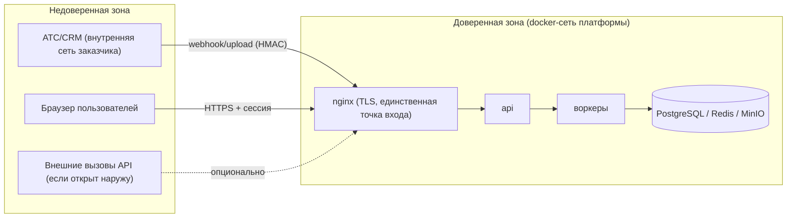
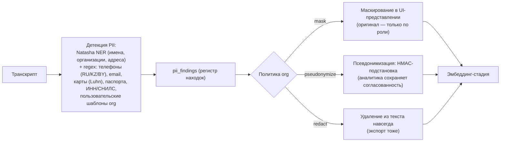

# 04. Безопасность и соответствие 152-ФЗ / GDPR

**Версия:** 1.0 · **Дата:** 2026-10-03

Документ описывает threat model, PII-конвейер, матрицу соответствия требованиям законодательства и модель доступа. Принцип: **конфигурация важнее обета** — все требования реализованы переключаемыми механизмами, у каждого заказчика включается свой профиль строгости.

---

## 1. Границы доверия и threat model (STRIDE)

| Угроза | Сценарий | Контрмера |
|---|---|---|
| **S**poofing | подделка webhook от АТС; кража сессии | HMAC-SHA256 подпись webhook + timestamp-окно 5 мин; JWT-сессии с ротацией, logout-инвалидация; OIDC/LDAP опционально |
| **T**ampering | правка транскриптов/скоров задним числом; подмена аудио | append-only `audit_log`; версии рубрик и моделей; content-hash аудио (sha256) при ингесте; правки только через `labels` с авторством |
| **R**epudiation | «я этого не говорил/не слушал» | аудит прослушиваний и экспортов; неизменяемые сегменты + слой правок; таймстемпы UTC |
| **I**nformation disclosure | утечка аудио/транскриптов наружу; PII в логах; SQL-инъекции | TLS everywhere; MinIO SSE + LUKS на хосте; никакой PII в логах (grep-правило в CI); параметризованные запросы (ORM); RBAC + row-level; аудио-ссылки — подписанные временные URL |
| **D**oS | флуд webhook/загрузками | rate limit на nginx/api; лимит размеров загрузки; очередь с backpressure |
| **E**levation | агент видит чужие звонки; повышение роли | row-level фильтр в сервисном слое + Postgres RLS; принцип минимальных привилегий на сервисы (отдельные роли БД); секреты — только env/secrets, не в коде |

Дополнительные hardening-правила (из security-практик): валидация всех входов на границе (reject, не sanitize); generic-ошибки наружу, стек-трейсы — в лог; security-заголовки (CSP, HSTS, X-Frame-Options, X-Content-Type-Options); dependency-аудит (pip-audit) в CI; secrets-сканирование истории git.

## 2. Классификация данных

| Категория | Примеры | Существенность |
|---|---|---|
| Аудио записей | голос клиента (биометрия по 152-ФЗ!) | критично |
| Транскрипты | речь в тексте, содержит ПДн | критично |
| ПДн клиентов | ФИО, телефоны, email, суммы, адреса | критично |
| Служебные ПДн | ФИО и номера сотрудников | важно |
| Метрики/агрегаты | скоры, статистика | внутренняя |
| Конфигурация/секреты | токены CRM, пароли БД | секреты |

Голос — биометрические ПДн особой категории чувствительности в трактовке Роскомнадзора: аудио требует максимальной защиты (это отражено в ретенциях и доступах ниже).

## 3. PII-конвейер (`polylog.pii`)

Расположение: стадия между `transcribed` и `analyzed` (транскрипт уже есть), работает до эмбеддингов.

- **Регистр находок** (`pii_findings`) — основа для эразуры: знаем, где именно лежит каждое ПДн.
- **Маскирование перед эмбеддингом** (режим strict): вектор строится по замаскированному тексту — ПДн не попадают в векторное пространство.
- **Аудио**: маскирование невозможно — доступ только по ролям + аудит; опция «автоудаление аудио после N дней, транскрипт остаётся» в ретенциях.
- Пользовательские шаблоны PII (per-org regex) — в админке.

## 4. Права субъектов и эразура

Операция `DELETE subject` (запрос от CRM-коннектора, из UI, по API):

1. Находим контакт → все телефоны → все звонки (`calls.contact_id` / через entity_links).
2. Каскад: аудио-файлы (MinIO delete) → `call_segments` → `objections/signals/violations` → `scores` → `risk_assessments` → `embeddings` (по entity_id) → `pii_findings`.
3. Транскрипты: физическое удаление текста (или обезличивание — политика org), записи `calls` обезличиваются (номера → хеш), служебная статистика остаётся без персон.
4. Датасеты: помечаем affected `dataset_hash` как contaminated; `training_runs`, использующие их, отмечаются; при следующем переобучении данные не попадают в выборку. Уже обученные модели: оцениваем по политике (рекомендация в документации — переобучение голов при массовых запросах эразуры).
5. Ответ: отчёт об удалении (для субъекта/Роскомнадзора) — PDF из шаблона.

Матрица соответствия:

| Требование 152-ФЗ | GDPR | Механизм в системе |
|---|---|---|
| Согласие на обработку ПДн (ст. 9) / уведомление о записи | Art. 6 legal basis | `consent_flag` из коннектора; конфиг «нет флага → не обрабатываем/обрабатываем в режиме обезличивания»; шаблоны IVR-объявлений в документации |
| Цели и минимизация (ст. 5) | Art. 5(1)(c) | PII-политики org, селективные маскирования, роли с минимумом доступа |
| Локализация баз (ст. 18) | — | self-hosted по определению; все модели локальные |
| Доступ субъекта (ст. 14, 20) | Art. 15 | экспорт данных субъекта (JSON/PDF) по запросу |
| Исправление (ст. 21) | Art. 16 | правки транскриптов через labels с аудитом |
| Удаление (ст. 21 ч.2) | Art. 17 | §4 эразура |
| Уведомление РКН об обработке (ст. 22) | — | инструкция в onboarding-документации (обязанность заказчика) |
| Защита при передаче (ст. 19) | Art. 32 | TLS, HMAC на webhook, подписанные URL аудио |
| Реестр операций обработки | Art. 30 | `audit_log` + выгрузка |

## 5. RBAC и аудит

| Роль | Звонки | Аудио | Транскрипты | Скоринг/рубрики | Админ | PII-политики |
|---|---|---|---|---|---|---|
| `admin` | все | да | да | да | да | да |
| `supervisor` | своя команда | да | да | да/правка | нет | нет |
| `analyst` | все (без ПДн по политике) | опция | да (маскированно) | чтение | нет | нет |
| `agent` | только свои | свои | свои | свои (чтение) | нет | нет |
| `dpo` | все | нет (по умолчанию) | маскированно | нет | аудит | да |

- Row-level: `agent` фильтруется по `agent_user_id` на уровне запросов + Postgres RLS как вторая линия.
- Аудиту подлежат: вход/выход, прослушивание аудио (кто/когда/какой звонок), экспорты, правки рубрик и PII-политик, операции эразуры, смена ролей.
- Экспорты обменного формата — отдельный аудит + опциональное подтверждение DPO.

## 6. Секреты и ключи

- Секреты — env-файлы/docker secrets, никогда в БД в открытом виде; `connectors.config_secret` — AES-256-GCM (ключ — env `POLYLOG_KMS_KEY`).
- Ротация: инструкция по ротации ключей и HMAC-секретов; HMAC-секреты per-коннектор.
- Бэкапы шифруются (restic + ключ отдельно от бэкапа).

## 7. Телеметрия

- По умолчанию выключена. Opt-in: только безличные события (версии, счётчики стадий, ошибки без payload). В OCI-сборке телеметрия скомпилирована отдельно и не содержит сетевых вызовов к вендору.
