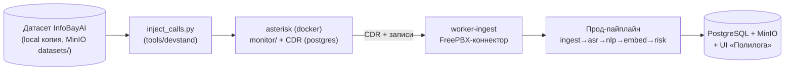

# 09. Dev-стенд: dockerized Asterisk + датасет как источник звонков

**Версия:** 1.0 · **Дата:** 2026-10-03 · Решения: [doc 06](06-datasets.md) §1.1, §6; ADR-17 (юр. отложено), ADR-18 (стенд вместо пилота)

Решено (2026-10-03): (1) голосовой датасет InfoBayAI — и тест распознавания, и источник звонков; (2) для разработки поднимаем dockerized Asterisk с «звонками» из датасета — пилотный заказчик на старте не нужен; (3) юридические проверки отложены (ADR-17).

---

## 1. Что проверяет стенд

1. **Реальный путь ингеста**: коннектор FreePBX → CDR + файлы записи → нормализация → пайплайн → БД/UI — без сигналинга и железа.
2. **Роли по каналам**: двухканальные записи датасета = ground truth для карты agent/client.
3. **Бенчмарк ASR** (если в датасете есть транскрипты): WER/RTF GigaAM-v3 vs T-one vs Whisper на «телефонном» аудио.
4. **Производительность и стабильность**: батч 100+ звонков overnight, state machine, ретраи, DLQ.
5. **Регресс моделей**: фиксированный набор звонков → сравнение метрик до/после обновления моделей.
6. **Демо-стенд для продаж**: те же контейнеры, локальные данные — показ заказчику без пилота.

## 2. Ключевое упрощение: эмулируем артефакты АТС, а не звонки

Контракт FreePBX-коннектора ([doc 02](02-modules.md) §1) потребляет две вещи: **CDR-записи** и **файлы записей**. Сигналинг (SIP/РТП) для этого не нужен — значит, стенд не проигрывает звонки в сеть, а воспроизводит то, что АТС оставляет после звонка: файл в `monitor/` + строку CDR. Это проще, детерминированнее и проверяет ровно наш интеграционный шов.



Опциональный режим 2 (демо): реальные SIP-звонки — два софтфона/шлюз + `Playback()` датасетного аудио — только для живых презентаций, в автотесты не входит.

## 3. Инжектор звонков (`tools/devstand/inject_calls.py`)

Вход: манифест датасета (путь, каналы, длительность, отрасль/метаданные). Действия на один «звонок»:

1. Копирует аудио в `…/monitor/<YYYY/MM/DD>/q-<rand>-<ext>-<in|out>.wav` по конвенции имён FreePBX;
2. Вставляет CDR-строку (cdr_pg): номера из пула фейковых E.164 (детерминированный фабрикатор «компаний/контактов» — заодно наполняет граф для Customer 360), время (реалистичные распределения: будни, 10–18), direction, duration = длительность файла, disposition (ANSWERED/NO ANSWER — для «пропущенных»);
3. Проставляет consent_flag=1, источник «devstand» (в UI бейдж «тестовые данные»);
4. Режимы: `--once`, `--batch N`, `--loop --rate 200/hour` (имитация рабочего дня), `--profile noisy` (добавляет шум/обрезки — стресс-тест ASR).

Детерминированность: сид на прогон → идемпотентные external_id → один и тот же набор звонков воспроизводим между прогонами (обязательное свойство для регресса моделей).

## 4. docker-compose профиль `devstand`

```yaml
  asterisk:
    image: ${DEV_ASTERISK_IMAGE:-local/asterisk-freepbx-cdr}   # свой образ: asterisk + cdr_pg_csv/ODBC
    profiles: [devstand]
    volumes:
      - ./devstand/monitor:/var/spool/asterisk/monitor
      - ./devstand/conf:/etc/asterisk
    environment: [PG_CONns=postgres:5432]                       # CDR пишет в общий postgres платформы
  devstand-injector:
    build: tools/devstand
    profiles: [devstand]
    command: ["--batch", "100", "--seed", "42"]
    depends_on: [asterisk, postgres, minio]
```

Образ Asterisk собирается один раз (Dockerfile в `tools/devstand/`): vanilla Asterisk + `cdr_pg_csv`/`res_odbc` + пустая диалплан — конфиг хранится в репо, никаких кастомных патчей. Пароль/секреты — через env.

## 5. Приёмочные проверки стенда

| # | Сценарий | Критерий |
|---|---|---|
| S1 | Smoke: 1 двухканальный звонок | E2E ≤ 10 мин, state=done, роли по каналам верны, транскрипт в UI |
| S2 | Батч: 100 звонков overnight | 0 задач в DLQ; SLA p95 ≤ 10 мин после инжекта |
| S3 | Роли: 200 dual-channel звонков | корректная карта каналов 100% (в т.ч. авто-переворот при тишине) |
| S4 | Моно-фолбэк: подмножество single-channel | pyannote-ветка работает, DER фиксируется в отчёте |
| S5 | WER-бенчмарк: GigaAM-v3 / T-one / Whisper × 2 варианта апсемпла | таблица WER/RTF/VRAM на эталоне датасета (§6) |
| S6 | Регресс моделей: повтор S5 после обновления | WER не хуже baseline − 0.5 п.п.; иначе блокер релиза |
| S7 | Стресс «пропущенные»: 20% NO ANSWER | не создают пустых анализов, метрики не искажаются |

## 6. Датасет как эталон распознавания

- **Если транскрипты в датасете есть** (чек-лист [doc 06](06-datasets.md) §1.1): эталон = стратифицированная выборка из транскриптов (по отраслям/длительности/шуму). Обязательно: **ручная сверка 20–30 звонков эталона** — датасетные транскрипты могут быть сами ASR-происхождения (проверить в карточке/сэмплах); грязный эталон = валидный WER не построить.
- **Если транскриптов нет**: ручной эталон минимального объёма 3–5 ч (≈ 60–100 звонков) — достаточно для приёмки ASR-связки; весь остальной датасет идёт через пайплайн как псевдоразметка (conf-фильтр) для NLI-пар и DAPT ([doc 07](07-nli-rubert-reuse.md) §5, сценарий B).
- Датасетные аудио — 8 кГц телефония: сразу проверяем полный граф апсемплинга (T-one нативно; GigaAM: soxr-VHQ vs линейный), как в [doc 06](06-datasets.md) §3.

## 7. Что стенд сознательно НЕ проверяет

Реальные кодеки/джиттер/потери, IVR и consent-объявления заказчика, реальную нагрузку multi-tenant — это зона пилота (M2+). Стенд проверяет наш код, пилот — интеграцию с чужой инфраструктурой.

## 8. Место в роадмапе и статус

**Стенд развёрнут и проверен (2026-10-04, S1+S2 PASSED):**

| Шаг | Результат |
|---|---|
| `docker compose --profile devstand up -d postgres` | Postgres 16 healthy |
| `docker compose run --rm injector` | 20 CDR-строк + 20 записей (bind в `data/monitor/`, sidecar-транскрипты рядом) |
| `python tools/devstand/run_ingest.py --backend stub` | **20/20 звонков done, 0 failed**: CDR → FreePBX-коннектор (рекурсивный поиск записей) → normalize (8к→16к dev-ресемплер) → stub-ASR (псевдотранскрипты GigaAM из sidecar) → PII → правила (**73 возражения, 14 сигналов**) → скоринг (avg 36.5/100) |
| Проверка БД | calls=20, segments=2487, objections=73, scores=20 — в docker-Postgres |

Попутно закрыты швы (найдены прогоном стенда): sidecar-транспорт через коннектор
(`download_sidecar` → `create_call_from_ref(sidecar=...)`, копирование при 16k-конвертации),
name/stem-конвенции sidecar в stub-ASR, naive-timestamp CDR, направленность по
суффиксу `-in/-out`. Реальный Asterisk-контейнер (`Dockerfile.asterisk`, andrius/asterisk) —
опциональный live-режим; CDR-потоку он не нужен (ADR-18).

- **M1 (недели 1–2)**: ✅ S1–S3 закрыты; бенчмарк S5 — GigaAM работает, ждёт ручной эталон ([doc 06](06-datasets.md) §6);
- **M2**: стенд как nightly-регресс (S6) + стресс S7; следующий контур — переход API-воркеров на Postgres-очередь (procrastinate) внутри стенда.
